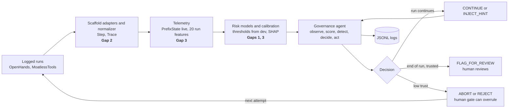

# TraceTrust: observability and runtime governance for software-engineering agents

AI4015 Agentic AI, project **G2-09** (*Observability and Trust in Agentic AI for Software Engineering*).
Muhammad Omer Khan (23I-0650). Base paper: SWE-Gym (Pan et al., ICML 2025).

TraceTrust watches a software-engineering agent's execution trace, step by step, and turns it into a calibrated trust
score and a governance decision. It answers two questions: will this run resolve its task, and what should be done
about it? It uses cheap telemetry from the trace, not an expensive LLM verifier.

**Main finding.** Telemetry reliably catches runs that did nothing and saves reviewers about two-thirds of their work,
across two agent frameworks. It cannot yet tell a correct patch from a plausible wrong one, it gives little warning early
in a run, and it doesn't save compute once failed attempts are retried.

- [Architecture](#architecture) | [Install and run](#install-and-run) | [Reproduce each experiment](#reproduce-each-experiment) | [Results](#results) | [Gap-resolution table](#gap-resolution-table) | [Failure analysis](#failure-analysis) | [Changes since Phase 1](#changes-since-phase-1) | [Limitations](#limitations)
- Development log: [docs/devlog.md](docs/devlog.md). Design details: [docs/architecture.md](docs/architecture.md).

## Architecture



**The agent** ([src/agent/](src/agent/)) replays a logged run and intercepts each action before it takes effect:

| Step | Tool | What happens |
|---|---|---|
| 1 | `score_prefix_risk` | At 5, 10, 15, 20, 30, 40 actions, score the run with a calibrated model |
| 2 | `abort_run` | Stop if risk passes the threshold, only at checkpoints with enough signal on dev (5 and 10) |
| 3 | `detect_patterns`, `inject_hint` | Check rule-based patterns; send a fixed hint for ones that passed a dev filter |
| 4 | `score_final_risk` | At the end, score the run with its patch: `REJECT`, or `FLAG_FOR_REVIEW`, with the top-3 factors |

Nothing is accepted automatically: at an 8% pass rate even high-trust runs mostly fail. After `ABORT` or `REJECT`, the agent moves to
another logged attempt at the same task. A human can approve, override or stop any `ABORT` or `REJECT` (`--interactive`). If a tool
fails, the agent logs it and fails open. The agent never reads the label, and reads the final patch only at the last step
(both enforced by tests).

**The agent does not use an LLM.** It uses logistic regression and fixed rules, as proposed in Phase 1. The LLMs are the agents being
observed and the two baselines (7B judge, 32B verifier). It runs in replay: logged runs can't react, so hints are logged but their
effect can't be measured.

| Gap | Component | Off switch |
|---|---|---|
| 1, calibration | [src/calibration.py](src/calibration.py), [src/agent/risk.py](src/agent/risk.py) | `--no-calibration` |
| 2, cross-framework | [src/data/moatless.py](src/data/moatless.py), [src/data/swebench_lite.py](src/data/swebench_lite.py) | `--no-normalizer` |
| 3, telemetry and early warning | [src/features.py](src/features.py), [src/prefix.py](src/prefix.py), [src/agent/patterns.py](src/agent/patterns.py) | `--no-telemetry`, `--no-early-warning`, `--no-hints` |

## Install and run

Python 3.11, on Windows (paths shown) or Linux/macOS (use `.venv/bin/python`). No GPU or paid API is needed for the agent.

```bash
uv venv --python 3.11
uv pip install --python .venv -r requirements.txt
.venv/Scripts/python -m pytest -q                        # 68 tests
```

The first command that needs data downloads it from Hugging Face. `data/` is gitignored, except `splits.csv` (fixed splits), `verifier_scores_lite.csv`
(from about 4.5 hours on Kaggle) and `llm_judge_cache.jsonl` (judge replies). `.env` is only needed to re-query the LLM judge; see [.env.example](.env.example).

```bash
.venv/Scripts/python -m src.run_baseline                  # about 3 min; builds the features the agent trains on
.venv/Scripts/python -m src.prefix --lite                 # prefix features for the checkpoints
.venv/Scripts/python -m src.agent.cli models              # fitted models and thresholds
.venv/Scripts/python -m src.agent.cli replay --uid s0r100 # one run, step by step
.venv/Scripts/python -m src.agent.cli replay --uid s0r100 --interactive   # you approve or override
.venv/Scripts/python -m src.agent.cli task --instance Project-MONAI__MONAI-2446   # abort and reroute across attempts
```

Logs go to `logs/<config>/<run>.jsonl`, one line per action. A sample is committed in [logs/sample/](logs/sample/).

## Reproduce each experiment

Data volumes: SWE-Gym 300 MB, OpenHands Lite 430 MB, MoatlessTools 440 MB. Seeds 42, 43, 44; bootstrap 1,000 task resamples. Times are on a laptop CPU.

| Experiment | Command | Output in `results/` |
|---|---|---|
| **E1** baselines | `python -m src.run_baseline --with-llm` | `metrics.*`, `reliability.png` |
| **E2** base paper | [experiments/kaggle_verifier.ipynb](experiments/kaggle_verifier.ipynb) (optional, scores are committed), then `python -m experiments.compare_verifier_lite` | `verifier_vs_telemetry_lite.*` |
| Verifier contamination | `python -m experiments.verifier_overlap` | `verifier_overlap.json` |
| **E3, E5** full system, ablation | `python -m experiments.governor_eval` (15 min) | `governor_eval.*`, `governor_outcomes_*.csv` |
| Agent settings, dev only | `python -m experiments.governor_tuning` | `governor_tuning.*` |
| **E4 Gap 1** | `python -m experiments.calibration` | `calibration.*` |
| **E4 Gap 2** | `python -m experiments.transfer_swebench_lite`, `python -m experiments.transfer_moatless` (25 min), `python -m experiments.gap2_paired` | `transfer_*`, `gap2_*` |
| **E4 Gap 3** | `python -m experiments.early_warning`, `feature_eval`, `explain`, `hybrid` (each `python -m experiments.<name>`) | `early_warning.*`, `feature_eval.*`, `shap_importance.*`, `hybrid_verifier.*` |
| **E6** cost, latency | `python -m experiments.efficiency` | `efficiency.*` |
| Failure analysis | `python -m experiments.failure_analysis` (after E3) | `failure_analysis.*`, `failure_cases.md`, `logs/sample/` |
| Validity checks | `python -m experiments.label_noise`, `extra_metrics`, `empty_workspace_check` | `label_noise.*`, `extra_metrics.*`, `empty_workspace_check.json` |
| Paper figures | `python -m experiments.figures` | `figures/` |

Run `.venv/Scripts/python`, not bare `python`. Timing numbers in `efficiency.*` vary by machine; everything else should match exactly.

**Evaluation rules.** All tuning uses dev: 80% of SWE-Gym tasks, with `GroupKFold` by task. The test set (20% of tasks, 488 tasks, 1,148 runs) is fixed in `data/splits.csv`.
The agent was locked at commit `4a3b1a6` before it ever ran on test, and E3/E5 ran once. SWE-bench Lite and MoatlessTools are never tuned on; a small number of labelled Lite
tasks may set the pass rate where stated. Features never include `test_result.report`, `test_output` or `apply_patch_output`, which contain the label.

## Results

Data: 6,055 SWE-Gym OpenHands runs (GPT-4o 5,826, Claude 229; 8.1% pass), 1,199 OpenHands runs on SWE-bench Lite (34% pass; unseen repositories), and 2,997
MoatlessTools runs on Lite (open-weight Qwen fine-tunes; main set 2,398 runs, 8 attempts per task, 19% pass).

### E1, E2: predictors

SWE-Gym held-out test (1,148 runs, 38 mixed tasks, 195 same-task pairs):

| Method | Pooled AUROC [95% CI] | Within-task AUROC [95% CI] | ECE |
|---|---|---|---|
| `length_only` | 0.695 [0.643, 0.743] | 0.733 [0.584, 0.862] | 0.037 |
| `empty_patch` | 0.713 [0.694, 0.732] | 0.703 [0.653, 0.769] | 0.029 |
| `prompt_only` | 0.657 [0.576, 0.730] | 0.500 (by construction) | 0.029 |
| `telemetry_lr` (11 features) | 0.812 [0.773, 0.853] | 0.764 [0.626, 0.859] | 0.019 |
| `telemetry20_lr` (20 features) | **0.836** [0.796, 0.878] | **0.779** [0.681, 0.864] | **0.014** |
| `telemetry_gbm` (11 features) | 0.835 [0.800, 0.871] | 0.749 [0.609, 0.855] | 0.024 |
| `telemetry20_gbm` (20 features) | 0.835 [0.801, 0.875] | 0.749 [0.620, 0.857] | 0.031 |

On runs that changed code (696 runs), `telemetry20_lr` gets 0.714 pooled and 0.629 within-task [0.500, 0.753]. AUPRC 0.255 at a 0.078 base rate; macro-F1 0.626 ([extra_metrics.md](results/extra_metrics.md)).

**Base paper, reproduced by us.** SWE-Gym's 32B verifier can't be fairly scored on SWE-Gym's own runs: it trained on 53.4% of those tasks, including every task with a passing run
([verifier_overlap.json](results/verifier_overlap.json)). So we ran it on 237 clean Lite runs (4-bit GGUF, Kaggle 2 x T4; 79 mixed tasks, 158 pairs):

| Method, same 237 runs | Pooled | Within-task | ECE |
|---|---|---|---|
| 32B verifier (reproduced) | 0.734 | 0.741 | 0.290 |
| `length_only` | 0.691 | 0.696 | 0.241 |
| `telemetry_gbm` | 0.609 | 0.665 | 0.363 |
| `telemetry20_lr` | 0.624 | 0.627 | 0.327 |

The verifier ranks significantly better than `telemetry_lr` (within-task +0.152 [+0.044, +0.266]) but not than two length features (+0.044 [-0.038, +0.139]).
SWE-Gym reports the verifier only through Best@k (26.0% on Lite at k = 16, taken from the paper; not comparable to our sample).

### E3, E5: the agent, with each component removed

SWE-Gym test, once, 89 passing runs (so "passes lost" has wide intervals):

| Config | Failures stopped | Passes lost | Runs reviewed | Pass rate in review | Tokens saved |
|---|---|---|---|---|---|
| **Full agent** | 68.8% [65.1, 72.3] | 12.4% [3.9, 20.3] | 35.5% [32.0, 39.3] | 19.1% [14.5, 23.9] | 9.8% [7.6, 12.2] |
| No calibration | same as full | same | same | same | same |
| No early warning | 65.8% [62.1, 69.3] | 11.2% [3.9, 18.4] | 38.4% [35.0, 42.0] | 17.9% [13.7, 22.4] | 0 |
| No telemetry | 37.9% [33.6, 42.1] | 6.7% [2.3, 12.5] | 64.5% [60.7, 68.6] | 11.2% [8.5, 14.4] | 0 |
| Empty-patch rule (comparison) | 42.7% [38.8, 46.4] | 0 | 60.6% [57.0, 64.4] | 12.8% [9.7, 16.2] | 0 |

Calibration changes nothing in-domain, as expected; hints change no outcome, by construction in replay. On SWE-bench Lite (K = 20 labelled tasks, mean over 3 draws), **calibration holds the false-alarm budget**:
8.3% of passes lost against the 10% budget, versus 20.9% without it. It also stops fewer failures (26.2% vs 48.9%). Early warning contributes nothing there.

Task-level, with reroute (488 tasks, 3 seeds):

| Policy | Tasks solved | Tokens per task | Reviews per task |
|---|---|---|---|
| One random attempt | 8.6% ± 0.7 | 14,099 | 1.00 |
| Empty-patch rule + reroute | 10.1% ± 0.6 | 18,875 | 0.82 |
| **Agent + reroute** | 10.1% ± 0.5 | 20,094 | 0.53 |
| Review every attempt | 12.9% | 31,511 | 2.15 |

The agent solves the same share as the simple rule, with 35% fewer reviews and 6% more tokens. The gain is reviewer time, not compute.

### E4: by gap

**Gap 1.** The Wilcoxon test confirms within-task ranking above chance (p < 0.001). Verifier ECE falls from 0.290 to 0.100 with Platt scaling (cross-fitted). Monotone calibration leaves Best@k unchanged. H1 (pooled AUROC overstates within-task) isn't supported: the gap's interval contains 0 on test, and it's negative for some methods on dev.

**Gap 2** ([gap2_moatless.md](results/gap2_moatless.md), [gap2_paired.md](results/gap2_paired.md)). Models fit on OpenHands, applied to MoatlessTools with nothing tuned:

| Method | SWE-Gym test | OpenHands, Lite | Moatless, normalized | Moatless, raw | Drop (normalized) | Retained | Within-task, normalized |
|---|---|---|---|---|---|---|---|
| `telemetry_lr` | 0.812 | 0.655 | 0.723 | 0.657 | 0.089 | 89% | 0.671 [0.606, 0.739] |
| `telemetry_gbm` | 0.835 | 0.636 | 0.740 | 0.731 | 0.095 | 89% | 0.686 [0.629, 0.743] |
| `telemetry20_lr` | 0.836 | 0.659 | 0.712 | 0.683 | 0.124 | 85% | 0.664 [0.600, 0.729] |
| `telemetry20_gbm` | 0.835 | 0.655 | 0.725 | 0.679 | 0.110 | 87% | 0.659 [0.587, 0.728] |

The normalizer's gain is significant for LR on the main set (+0.066 and +0.028 pooled), not reliably otherwise. Length reverses across frameworks (0.347, below chance). The agent's abort doesn't transfer: on MoatlessTools it costs more passes (16.7 points) than the failures it adds (12.6), and the simple rule beats the agent (20.7% vs 19.2% solved).

**Gap 3** ([shap_importance.md](results/shap_importance.md), [hybrid_verifier.md](results/hybrid_verifier.md), [early_warning.md](results/early_warning.md)). `patch_empty` ranks first on every dataset, and patch features hold about half of total SHAP. H3's named signals don't lead: `max_identical_streak` ranks 8, `error_responsiveness` 18, `thought_action_mismatch` 17 of 20.
The primary hybrid (verifier + `telemetry20_lr`) misses its target: 0.677 vs 0.741 within-task (difference -0.063 [-0.158, +0.019]), though ECE improves to 0.084. Live early warning is weak: AUROC 0.65 and 24.1% failure recall after 5 actions, near chance from 15 actions.

### E6: efficiency and reliability

| Step | Time per run |
|---|---|
| Feature extraction | about 0.3 ms |
| End-of-run score | about 5 ms |
| Full agent replay (19 actions on average) | about 20 ms, about 1 ms per action |
| 7B judge (RTX 4050) | 10.0 s |
| 32B verifier (Kaggle 2 x T4) | 75.7 s |

The agent takes about 0.03% of the verifier's time, on different hardware. It uses no LLM tokens, GPU or paid API. Reliability: 0 failed tool calls in E3, identical decisions on repeat (1,148 of 1,148), and fail-open behavior covered by tests. With 7.8% of passing labels flipped, results barely move: pooled 0.836 to 0.839, within-task 0.779 to 0.765 ([label_noise.md](results/label_noise.md)).

## Gap-resolution table

Base-paper columns: SWE-Gym reports only Best@k, so "reproduced" values are our own run of its verifier on 237 Lite runs.

| Gap | Method / component | Metric | Base paper result | Our result | Addressed? |
|---|---|---|---|---|---|
| **1** Within-task discrimination and calibration | Within-task evaluation, prior-shift and Platt calibration | Within-task AUROC ≥ 0.68, p < 0.01 | Not reported; reproduced 0.741 on Lite | 0.779 [0.681, 0.864], p < 0.001 on SWE-Gym test; 0.627 on the verifier's Lite runs | **Partially** |
| | | ECE cut ≥ 40%, to ≤ 0.06 | Not reported; reproduced ECE 0.290 | 0.100 (66% cut); ≤ 0.06 not met | |
| | | Best@k not harmed | 26.0% at k = 16 (from paper) | Unchanged by monotone calibration | |
| **2** Cross-framework transfer | Scaffold adapters and normalizer, OpenHands to MoatlessTools | AUROC drop ≤ 0.08 (≥ 85% retained) | Single scaffold, not tested | Drop 0.089-0.124 (not met); 85-89% retained (met) | **Partially** |
| | | Raw features drop > 0.20 | Not tested | 0.10-0.16: not supported | |
| | | Agent decisions transfer | Not tested | Abort doesn't transfer | |
| **3** Explainable telemetry, early warning | 20 features, linear SHAP, hybrid, prefix monitor, governance agent | ≥ 90% of verifier's within-task AUROC, < 1% latency | Reproduced 0.741, 75.7 s/run | 85% (`telemetry20_lr`), 90% (`telemetry_gbm`); about 0.03% latency | **Partially** |
| | | Hybrid adds ≥ 0.02 | Not reported | -0.063 [-0.158, +0.019]: not met | |
| | | ≥ 60% failure recall at 50% prefix, 10% FAR, ≥ 25% tokens saved | Post-hoc only | 58.7%, 50.1% saved, using a length leak; live: 24.1% at 5 actions, 23.5% saved: not met | |
| | | H3's named signals rank top in SHAP | Black box | Not supported; top is `patch_empty` | |

## Failure analysis

Wrong decisions on test ([failure_analysis.md](results/failure_analysis.md)); representative trajectories, chosen by a fixed rule, are in [failure_cases.md](results/failure_cases.md).

| Category | Count | Note |
|---|---|---|
| Missed failure, looks verified: the last check passed after the last edit, and the patch is still wrong | 285 (86.4% of missed) | Same kind of run passes 21.1% of the time, so telemetry can't separate them |
| Missed failure, last check failed or unknown | 31 (9.4%) | None of this kind passed on test; 26.5% did on Lite |
| Missed failure, no check after the last edit | 14 (4.2%) | |
| Lost pass, rejected at the end | 7 | Most-negative factor: large patch (5), long run (2) |
| Lost pass, aborted early | 4 | All at the 5-action checkpoint |
| Hint false alarms: passing runs hinted | 23 of 578 hinted | All `repeat_loop` |

## Changes since Phase 1

**Evaluation and data**
- 5-fold CV over everything became a fixed held-out test set plus `GroupKFold` on dev, so tuning can't touch reported numbers.
- The released runs are GPT-4o and Claude on SWE-Gym training tasks, with no released verifier scores. Report section B.7 had listed repeated SWE-bench rollouts with verifier scores as to be confirmed.
- The verifier ran on 237 clean Lite runs, not about 500 test runs, because it is contaminated on SWE-Gym's runs.
- Repository-level splits were not added; Lite and MoatlessTools serve as unseen-repository tests.
- SWE-agent was not added (it was optional). MoatlessTools is the second framework.

**Agent**
- `ABORT_AND_REROUTE` became `ABORT` plus a separate reroute step. `REJECT` and `FLAG_FOR_REVIEW` were added, because auto-accepting at an 8% pass rate would pass mostly failures.
- Thresholds use a false-alarm budget on dev. The token-budget utility function and conformal thresholds were not built.
- Hints are fixed text from 2 of 6 candidate patterns, kept by a dev rule. Hint windows like t ≤ 12 were not used.
- The Streamlit dashboard (optional) was not built.

**Methods**
- 20 features as promised, but not the exact list: tokens per step, step variance, phase proportions, 4-gram loops and rollback count were replaced by `phase_entropy`, `max_identical_streak` and others. No scaffold-specific `AgentStepSpan` type: `Step` and `Trace` play that role.
- The main early-warning result uses absolute checkpoints, because 25/50/75% prefixes need the run's total length, which leaks it. Prefix results are still reported.
- Temperature scaling wasn't implemented (Platt, isotonic and prior shift were). SHAP is exact linear SHAP on the LR model; TreeSHAP wasn't used.
- Added beyond the plan: empty-patch baseline, shortcut subsets, task-level bootstrap intervals, contamination check, reroute simulation.

## Limitations

- **Replay.** Logged runs can't react, so hint effects are unmeasured, and reroute draws on other logged attempts.
- **Small numbers.** Test has 89 passing runs and 38 mixed tasks, so intervals are wide.
- **Mixed pairs.** Same-task pairs on SWE-Gym and OpenHands Lite partly compare models or versions. MoatlessTools' 8-run set avoids this.
- **Verifier.** Run 4-bit, not bf16, with truncation to 32k tokens; on a sample of 237; timed on different hardware.
- **Closed models.** Most SWE-Gym runs come from GPT-4o, which isn't open-weight.
- **Labels.** Benchmark labels contain false positives (Wang et al., ICSE 2026). Token counts are chars/4 estimates.
- **Selection on dev.** Settings were chosen after seeing dev; the rules are recorded in the scripts, and test was used once.

## Repository layout

| Path | Contents |
|---|---|
| [src/agent/](src/agent/) | Governor loop, risk models, patterns and hints, reroute, CLI |
| [src/data/](src/data/) | Loaders and adapters: SWE-Gym, SWE-bench Lite, MoatlessTools |
| [src/](src/) | `schema.py` contracts, `features.py`, `prefix.py`, `calibration.py`, `baselines/`, `eval/`, `llm/` |
| [experiments/](experiments/) | One script per experiment |
| [results/](results/) | Every reported number, and paper figures in `figures/` |
| [logs/sample/](logs/sample/) | Sample agent logs |
| [tests/](tests/) | Tests for deterministic components |
| [docs/](docs/) | Development log, architecture, references |
