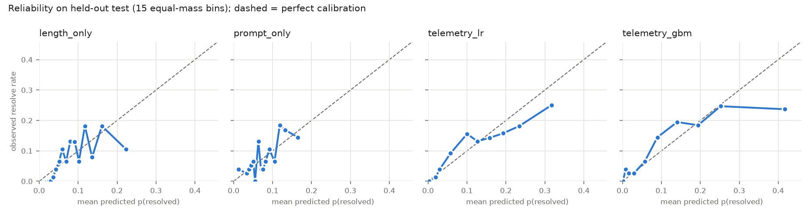

# TraceTrust-SE: Phase 1 baseline

TraceTrust predicts whether a software-engineering agent’s run has succeeded, using only its execution trace. It converts raw agent logs (OpenHands, MoatlessTools) into a shared step schema, extracts telemetry features such as error loops, step counts and test behaviour, and trains lightweight classifiers that output a calibrated trust score with feature-level explanations. Following SWE-Gym (Pan et al., ICML 2025), it compares against the SWE-Gym 32B verifier, a zero-shot LLM judge and simple baselines. It reports within-task AUROC (separating passed and failed runs of the same task) alongside pooled AUROC and calibration error. A replay-mode governance agent uses the score to decide whether to continue, hint or stop a run.

AI4015 Agentic AI, project **G2-09** (*Observability and Trust in Agentic AI for Software Engineering*).
Muhammad Omer Khan (23I-0650). Base paper: SWE-Gym (Pan et al., ICML 2025).

Given the execution trace of an OpenHands software-engineering agent, predict whether the run
resolved its task (its final patch passes the hidden tests). The output is a calibrated
probability that can serve as a trust score, rank runs of the same task (best-of-n), or flag runs
for review.

This repository is the **Phase 1 technical foundation**: data pipeline, structured contracts, the
baselines from the proposal (§B.10), and the evaluation protocol with initial results. The design
is in [docs/architecture.md](docs/architecture.md).

## Quick start

Requires Python 3.11 and [uv](https://docs.astral.sh/uv/) (or plain `pip`). Windows paths are shown; on
Linux/macOS use `.venv/bin/python`.

```bash
uv venv --python 3.11
uv pip install --python .venv -r requirements.txt

.venv/Scripts/python -m src.run_baseline            # downloads ~300 MB on first run, then ~1 min
.venv/Scripts/python -m pytest -q                   # unit tests
```

`run_baseline` downloads the dataset from Hugging Face, parses every trace, builds features and
folds, runs the baselines (5-fold CV on dev, then the held-out test set), and writes `results/`. Each stage caches
its output in `data/`; pass `--refresh` to rebuild.

### LLM-judge baseline (optional)

```bash
cp .env.example .env        # then pick a provider
.venv/Scripts/python -m src.run_baseline --with-llm
```

| `LLM_PROVIDER` | setup |
|---|---|
| `ollama` (default, used for the results below) | install [Ollama](https://ollama.com), then `ollama pull qwen2.5-coder:7b` (fits in 6 GB VRAM) |
| `groq` / `openrouter` | open-weight models on free tiers; key in `GROQ_API_KEY` / `OPENROUTER_API_KEY` |
| `gemini` | closed-weight fallback only; free key from Google AI Studio in `GEMINI_API_KEY` |

The judge runs on a fixed 50-run sample and caches every reply in `data/llm_judge_cache.jsonl`.

## Data

[`SWE-Gym/OpenHands-Sampled-Trajectories`](https://huggingface.co/datasets/SWE-Gym/OpenHands-Sampled-Trajectories):
6,055 OpenHands runs (GPT-4o 5,826, Claude 3.5 Sonnet 229) on 2,438 SWE-Gym tasks from 11 Python
repositories, 1 to 10 runs per task.

| | |
|---|---|
| resolved rate | 8.1% |
| tasks with only failed runs / only resolved runs / both | 2,144 / 106 / 188 |
| runs in mixed tasks | 1,037 (1,394 same-task pass/fail pairs) |

**Leakage rule:** `test_result.report`, `test_output` and `apply_patch_output` are never read as
features, because they contain the label. Only the trajectory and the final git patch are used.

## Pipeline

```
HF Hub -> loader (light columns) -> parser (streams row groups -> Trace) -> features (RunFeatures, TaskFeatures)
       -> splits (fixed dev/test by task, GroupKFold on dev, 50-run judge sample) -> baselines -> metrics -> results/
```

| module | role |
|---|---|
| [src/data/loader.py](src/data/loader.py) | download shards, light metadata table, dataset stats |
| [src/data/parser.py](src/data/parser.py) | OpenHands messages -> `Trace` of typed `Step`s (tool, command, path, exit code, error) |
| [src/schema.py](src/schema.py) | Pydantic contracts passed between every stage |
| [src/features.py](src/features.py) | telemetry features per run + pre-execution task features |
| [src/eval/splits.py](src/eval/splits.py) | fixed dev/test split by task, 5-fold GroupKFold on dev, judge sample -> [data/splits.csv](data/splits.csv) |
| [src/eval/metrics.py](src/eval/metrics.py) | pooled AUROC, within-task AUROC, Brier, ECE |
| [src/baselines/tabular.py](src/baselines/tabular.py) | length-only, prompt-only, telemetry LogReg / GBM |
| [src/llm/provider.py](src/llm/provider.py) | `LLMProvider` interface: Ollama + OpenAI-compatible free tiers |
| [src/baselines/llm_judge.py](src/baselines/llm_judge.py) | zero-shot LLM judge with JSON-validated verdicts |
| [src/baselines/verifier_stub.py](src/baselines/verifier_stub.py) | `Verifier` interface for the SWE-Gym 32B verifier (Phase 2, Kaggle) |
| [src/run_baseline.py](src/run_baseline.py) | end-to-end runner |

## Evaluation protocol

- **Splits** ([data/splits.csv](data/splits.csv), committed, built by `python -m src.eval.splits --rebuild`):
  20% of tasks (488 tasks, 1,148 runs) are a held-out **test** set, used only for final numbers.
  Mixed tasks are split separately so test gets its share of them (38 of 188). The other 80%
  (**dev**) is split with `GroupKFold(5)` on `instance_id`; model selection, calibration fitting and
  threshold tuning use dev only. No task appears in more than one fold or in both dev and test.
  All methods share the same assignment.
- **Reported numbers:** out-of-fold on dev, and on test after refitting on all of dev.
- **Pooled AUROC:** over all predictions in the evaluation set.
- **Within-task AUROC:** over tasks with both resolved and unresolved runs, the share of same-task
  (pass, fail) pairs ranked correctly. It removes task difficulty and measures what best-of-n
  selection needs (proposal Gap 1).
- **Calibration:** Brier score, ECE over 15 equal-mass bins, reliability diagram.

## Initial results

Held-out test set, 1,148 runs, 38 mixed tasks / 195 same-task pairs (from [results/metrics.md](results/metrics.md)):

| method | pooled AUROC | within-task AUROC | Brier | ECE |
|---|---|---|---|---|
| length_only | 0.695 | 0.733 | 0.0703 | 0.0368 |
| prompt_only | 0.657 | 0.500 | 0.0699 | 0.0294 |
| telemetry_lr | 0.812 | **0.764** | **0.0657** | **0.0190** |
| telemetry_gbm | **0.835** | 0.749 | 0.0661 | 0.0238 |

Dev, out-of-fold, 4,907 runs, 150 mixed tasks / 1,199 pairs:

| method | pooled AUROC | within-task AUROC | Brier | ECE |
|---|---|---|---|---|
| length_only | 0.703 | 0.818 | 0.0729 | 0.0166 |
| prompt_only | 0.638 | 0.500 | 0.0740 | 0.0140 |
| telemetry_lr | **0.844** | **0.865** | **0.0654** | **0.0094** |
| telemetry_gbm | 0.842 | 0.847 | 0.0662 | 0.0216 |



Observations so far:

- Telemetry features beat both simple baselines on discrimination and calibration. The strongest
  signals ([results/metrics.json](results/metrics.json), `telemetry_lr_coefficients`) are an empty
  final patch (strongly negative), the number of distinct tools used, run length and patch size.
- `prompt_only` reaches 0.64 to 0.66 pooled AUROC from task difficulty alone, yet 0.5 within-task by
  construction. Pooled AUROC alone overstates what a predictor knows about an individual run.
- H1 (pooled AUROC overstates within-task AUROC) is not settled. On dev, within-task AUROC is
  higher than pooled; on test it is lower (0.76 vs 0.81 for `telemetry_lr`). Test has only 38 mixed
  tasks and 195 pairs, so the gap is within noise. Most tasks have 1 to 3 runs, so this needs
  re-testing with confidence intervals and on the k = 16 evaluation rollouts.
- On the label-balanced 50-run judge sample, every model's Brier and ECE degrade sharply (ECE about
  0.4) while its ranking holds. That is prior shift: models fit to an 8% base rate are miscalibrated
  on a 50% one, the same problem the proposal attributes to the 50/50-trained SWE-Gym verifier.

### Zero-shot LLM judge (50-run sample)

Qwen2.5-Coder-7B via Ollama, 0 parse failures, about 10 s per run on an RTX 4050. Every method
scored on the same 50 runs (25 test tasks, one resolved and one failed run each; the trained
models are fit on dev):

| method | pooled AUROC | within-task AUROC | Brier | ECE |
|---|---|---|---|---|
| length_only | 0.744 | 0.680 | 0.3946 | 0.4196 |
| prompt_only | 0.500 | 0.500 | 0.4195 | 0.4090 |
| telemetry_lr | 0.782 | **0.800** | 0.3751 | 0.3988 |
| telemetry_gbm | **0.834** | 0.760 | 0.3468 | 0.3818 |
| llm_judge | 0.750 | 0.740 | **0.2594** | **0.2410** |

- The judge is right on 35 of 50 runs (70%) but ranks runs worse than the telemetry models, at
  about 10,000x the cost per run.
- Its confidence is always between 90 and 100, including on the 15 runs it gets wrong. Its stated
  confidence carries almost no information, so the score comes almost entirely from the PASS/FAIL verdict.
- Its lower Brier and ECE here are not a calibration win. The sample is 50% resolved, and the judge
  is not anchored to any base rate, while the trained models are calibrated to the real 8%. It calls
  7 of 25 failed runs PASS; at the full dataset's 92% failure rate that would label roughly 3 in 10
  runs PASS when only 8% actually succeed.

## Changes since Phase 1

- **Held-out test split (Oct 25).** Phase 1 reported 5-fold out-of-fold numbers over all runs, with
  no data kept back from tuning. Phase 2 tunes calibrators and alarm thresholds, so 20% of tasks
  are now a fixed test set and the folds cover dev only. The assignment is committed as
  `data/splits.csv`. The 50-run judge sample is unchanged; its tasks are pinned to test.

## Roadmap (Phase 2+)

SWE-Gym 32B verifier scores (Kaggle), prefix features at 25/50/75% for early warning, the full
20-feature schema, post-hoc and prior-shift calibration, cross-scaffold transfer (MoatlessTools,
SWE-agent), and the runtime governance monitor.
